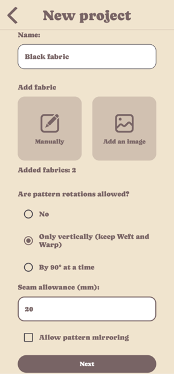
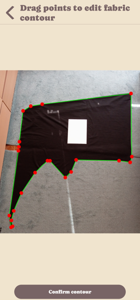
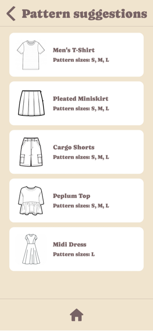
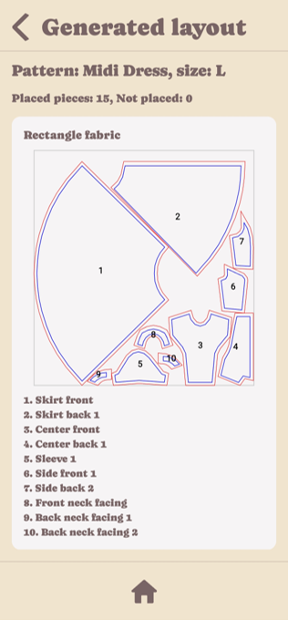
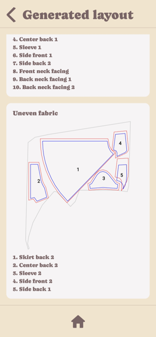

# FitPattern – Sewing Pattern Layout Optimizer

An Android application built with Kotlin and Compose Multiplatform that helps users reuse leftover fabric by automatically generating sewing pattern layouts on irregularly shaped fabric pieces.

Developed as a Bachelor's thesis at **Czech Technical University in Prague (CTU FIT), 2026**.

## Overview

Manually determining whether a sewing pattern fits a piece of leftover fabric can be difficult, especially when accounting for irregular shapes, grain direction, and seam allowances.

This application addresses the problem by allowing users to define fabric pieces, browse sewing patterns, and generate layouts that respect sewing-specific constraints.

## Screenshots

### Project Creation

### Fabric Detection

### Pattern Selection

### Generated Layout

| Layout – Part 1 | Layout – Part 2 |
|:---:|:---:|
|  |  |

## Features

- **Fabric input:** Define fabric dimensions manually or import photographs of irregularly shaped fabric pieces.
- **Image processing:** Detect fabric contours using OpenCV, with A4-based perspective correction and interactive contour editing.
- **Pattern selection:** Browse available sewing patterns and select garment sizes.
- **Layout generation:** Arrange irregular pattern pieces across multiple fabric remnants while respecting grain direction, seam allowance, and rotation constraints.
- **Project management:** Save projects and generated layouts locally for later access.

## Technical Highlights

- Implemented a custom heuristic nesting algorithm inspired by **beam search**, combining candidate-based placement, geometric validation, scoring, and local refinement.
- Designed a layered architecture separating presentation, shared domain logic, and persistence.
- Used polygon-based geometric representations to handle irregular fabric and pattern shapes.

## Tech Stack

**Kotlin · Compose Multiplatform · OpenCV · Room · SQLite · Coroutines · Kotlinx Serialization · KSP**

## Testing

- 259 unit tests covering geometry, solver logic, image-processing helpers, and application state.
- 67 Android instrumented tests covering UI behavior and application workflows.
- Manual usability testing with three participants.

**Note:** The project is a functional prototype. The heuristic algorithm does not guarantee a globally optimal layout, and importing external pattern files is not currently supported.
